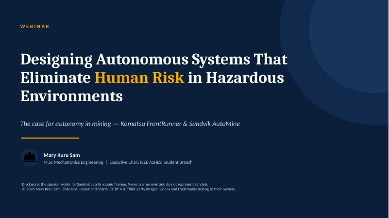

# Designing Autonomous Systems That Eliminate Human Risk in Hazardous Environments

**Invited talk** · UET Taxila webinar (online) · 2026
**Speaker:** Mary Kuru Sam, M.Sc. Mechatronics Engineering

[](slides.pdf)

📄 **[Slides (PDF)](slides.pdf)**

## Abstract

Mining remains one of the most dangerous industrial environments: ICMM member companies
recorded 42 fatalities in 2024, and powered haulage caused 39% of US mining deaths in 2025.
Personal protective equipment sits at the bottom of the hierarchy of controls: it protects
workers inside the hazard zone but cannot remove them from it. This talk makes the case for
autonomy as an elimination-level control, using two industrial systems: Komatsu FrontRunner,
autonomous haulage at surface mines since 2008 and now over 1,000 trucks, and Sandvik
AutoMine, autonomy underground where there is no GPS. It closes with the gaps that remain:
vendor lock-in, people still working inside automated zones, artisanal mining and cost.

## Topics

- The scale of the problem: global and US mining fatality data
- Why PPE isn't curbing it: the hierarchy of controls
- Komatsu FrontRunner: autonomous haulage at surface mines
- Sandvik AutoMine: autonomy underground
- Safety standards: ISO 17757, ISO 21815, IEC 61508 / ISO 26262
- Adoption so far and what's next

## Cite this talk

```
Sam, M. K. (2026). Designing Autonomous Systems That Eliminate Human Risk in Hazardous
Environments [Invited talk]. UET Taxila Webinar.
```

## Sources, credits and licence

All statistics are referenced on the *References & credits* slide.

- **Licence:** © 2026 Mary Kuru Sam. Slide text, layout and charts are licensed under
  [CC BY 4.0](https://creativecommons.org/licenses/by/4.0/): you may reuse them with credit.
- **Not covered by the licence:** third-party material. Photos © Komatsu and © Sandvik, the
  linked videos © their owners, and the Komatsu, FrontRunner, Sandvik, AutoMine and
  Caterpillar trademarks belong to their owners.
- **Disclosure:** the speaker works for Sandvik as a Graduate Trainee. The views here are her
  own and do not represent Sandvik.
