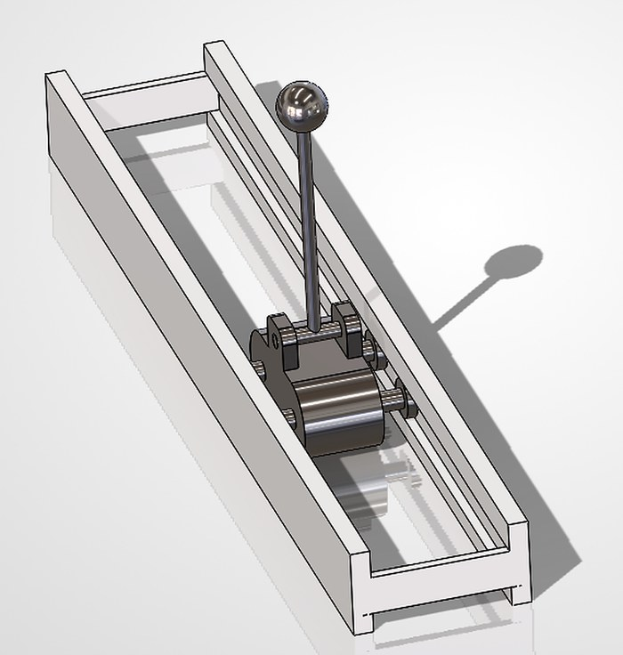
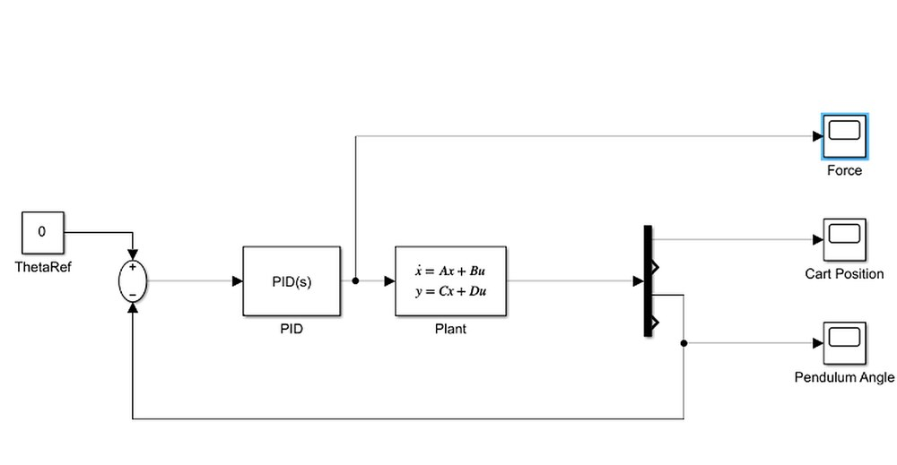
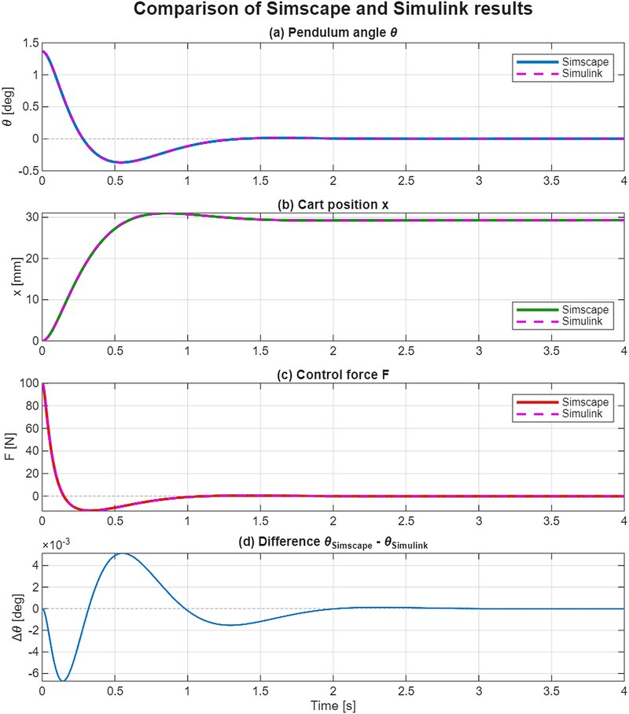

**Course project, Dynamics · Ashesi University × ETH Zürich · October 2026**
**Tools:** MATLAB, Simulink, Simscape Multibody, SolidWorks, Control System Toolbox

[**Code on GitHub**](https://github.com/MaryKuruENG/inverted-pendulum-pid-simscape) · [**Report (PDF)**](/files/MaryKuruSam_Inverted_Pendulum_Report.pdf)

## Overview

An inverted pendulum on a cart is unstable: left alone it falls. I modelled the system from first
principles, designed a PID controller that keeps the pendulum upright, and checked the analytical
model against a physics-based simulation built directly from my SolidWorks CAD assembly.

1. **Analytical model:** equations of motion from the Lagrangian, linearised about the upright
   position, as a state-space model and transfer function. The upright position has an unstable
   pole at +4.72 rad/s.
2. **Control design:** a PID controller with a filtered derivative, tuned for a 60° phase margin
   and simulated on both the linear and nonlinear models in Simulink.
3. **CAD validation:** the SolidWorks assembly was imported into Simscape Multibody with the same
   controller, and the two models were run from the same initial tilt (1.37°).

## Results

The controller brings the pendulum upright in about 1.2 s, with a peak force of 100 N, and stays
stable for ±20 % changes in pendulum and cart mass. The analytical and CAD-based models agree
to within **0.0067°** in pendulum angle:

| Metric | Simulink (analytical) | Simscape (CAD) |
|---|---|---|
| Settling time (2 %) | 1.219 s | 1.224 s |
| Undershoot past upright | 27.4 % | 27.1 % |
| Peak control force | 100.1 N | 100.0 N |
| Cart final position | 29.3 mm | 29.4 mm |

## What I learned

- Turning a CAD assembly into a working multibody simulation: replacing the rigid welds from
  the import with a prismatic joint for the cart, and correcting the joint angle offset so that
  0° means upright.
- Small modelling choices matter. The remaining difference between the models comes mostly from
  the wheels' rotational inertia, which the analytical model includes and the CAD model leaves
  free to spin.
- A PID loop on the angle alone balances the pendulum but lets the cart drift after a disturbance.
  An outer loop on cart position (cascade control) or LQR fixes this, and is my next step.
