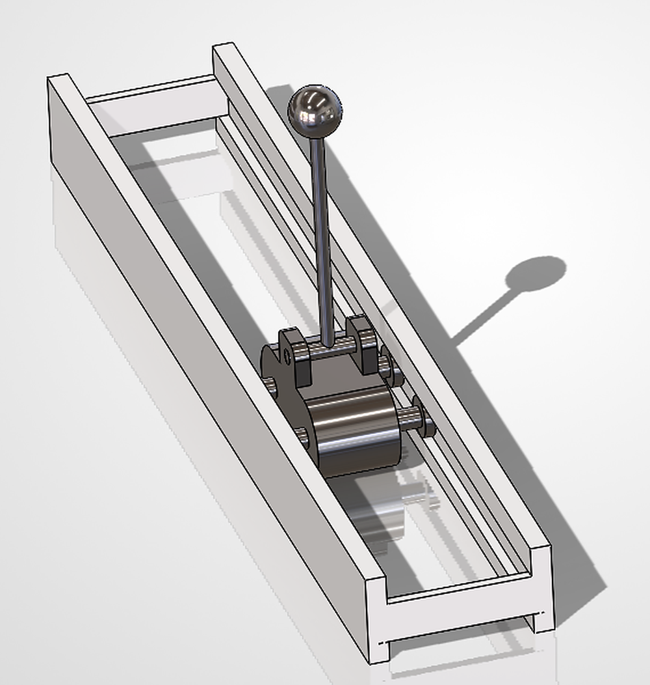
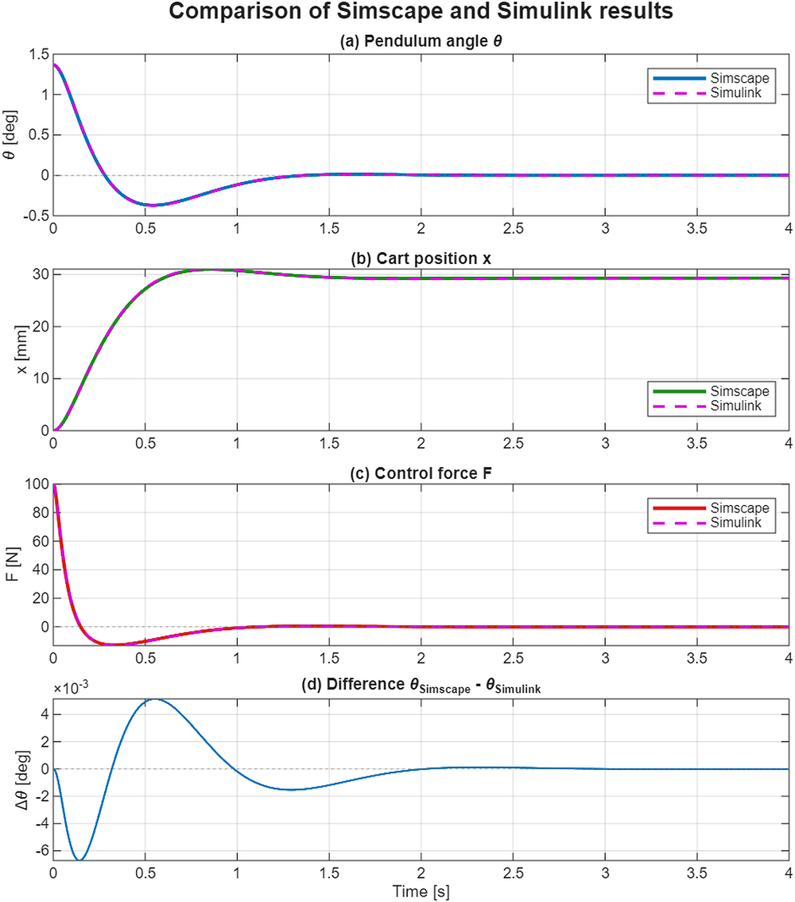
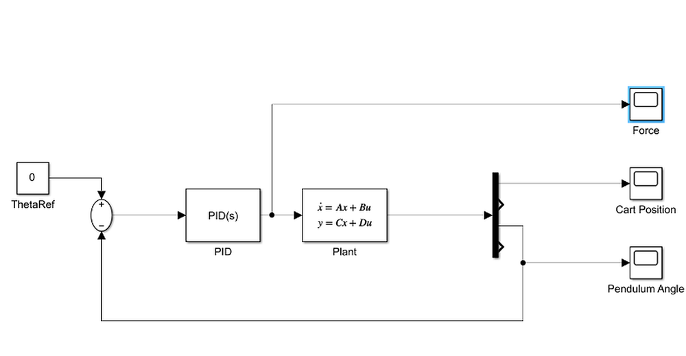
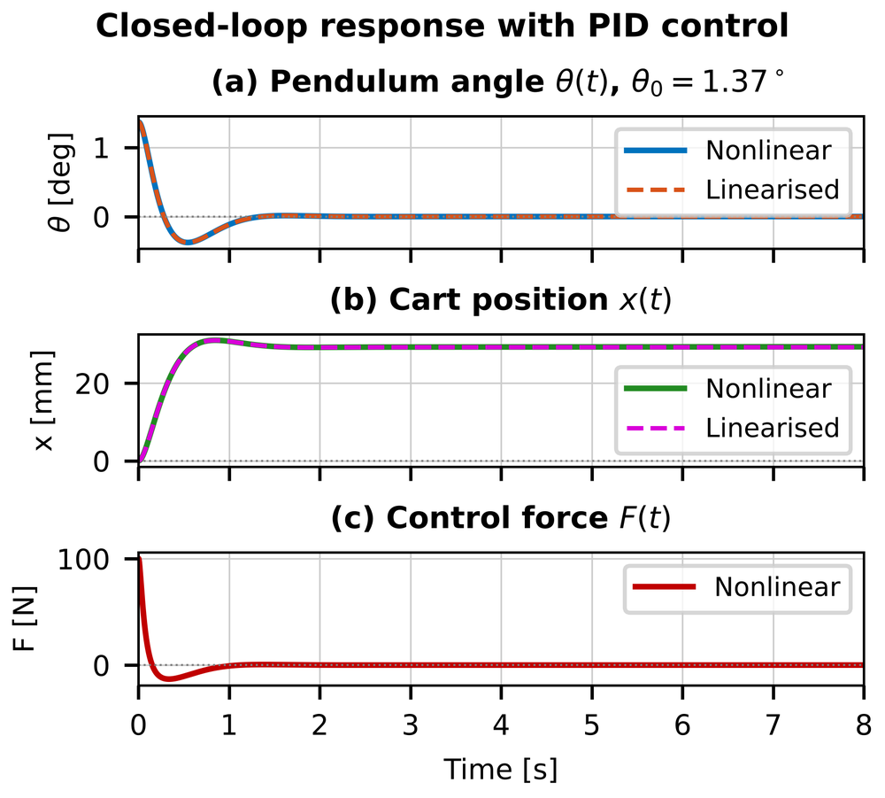
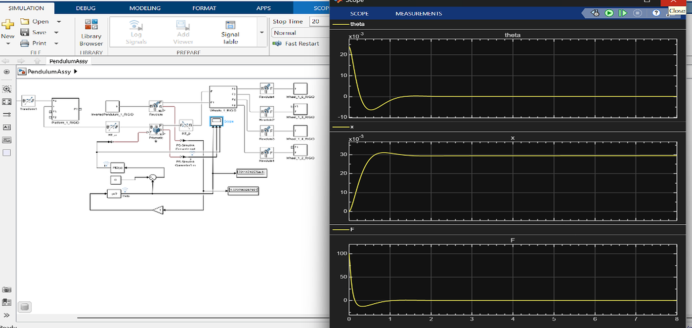

# Inverted Pendulum on a Cart: Modelling, PID Control and Simscape Simulation


A cart–pendulum system modelled from first principles, stabilised with a PID controller in
MATLAB/Simulink, and validated against a CAD-based Simscape Multibody model built from a
SolidWorks assembly. Course project for **Dynamics**.

<p align="center">
  
</p>

## Overview

| Phase | What was done | Tools |
|---|---|---|
| 1. Analytical model | Equations of motion with the Lagrangian method, linearisation about upright, state-space model and transfer function | MATLAB, Symbolic Math Toolbox |
| 2. Control design | PID controller with filtered derivative, tuned for a 60° phase margin, simulated on the linear and nonlinear models | MATLAB, Simulink, Control System Toolbox |
| 3. CAD validation | SolidWorks assembly imported into Simscape Multibody, same PID gains, results compared with the analytical model | SolidWorks, Simscape Multibody Link |

## Key results

The upright pendulum is open-loop unstable (pole at **+4.72 rad/s**). The PID controller
(Kp = −4192.9, Ki = −8365.6, Kd = −645.6, Tf = 0.01 s) balances it from the 1.37° tilt of the
CAD pose:

| Metric | Simulink (analytical) | Simscape (CAD) | Difference |
|---|---|---|---|
| Settling time (2 %) | 1.219 s | 1.224 s | +0.4 % |
| Undershoot past upright | 27.43 % | 27.05 % | −1.4 % |
| Peak control force | 100.12 N | 99.97 N | −0.15 % |
| Cart peak / final position | 31.05 / 29.26 mm | 30.98 / 29.41 mm | −0.2 / +0.5 % |

The two models agree to within **0.0067°** in pendulum angle (RMS 0.0014°). Phase margin 60°,
peak sensitivity 1.16, and the loop stays stable for ±20 % changes in pendulum and cart mass.

<p align="center">
  
</p>

<details>
<summary>More figures</summary>

**Simulink model and closed-loop response (Phase 2)**




**Simscape Multibody model and scope output (Phase 3)**


</details>

## Repository structure

```
matlab/   MATLAB scripts, Simulink and Simscape models, data files, STEP geometry
cad/      SolidWorks assembly and parts
report/   Project report (PDF) and its LaTeX source
docs/     Figures used in this README
```

Keep every file in `matlab/` in the same folder: the Simscape model loads the `*_sldprt.STEP`
geometry files by name.

## How to run

Requires MATLAB R2025b with Simulink, Control System Toolbox, Symbolic Math Toolbox and
Simscape Multibody.

1. Open MATLAB and set `matlab/` as the current folder.
2. `derive_symbolic` – derives the equations of motion and the A, B matrices.
3. `main_pid_inverted_pendulum` – designs the PID controller, saves `pid_gains.mat`, plots the response.
4. `build_simulink_pid_model` – builds and runs `pendulum_pid.slx` (scopes + results figure).
5. `PendulumAssy_DataFile`, then open `PendulumAssy.slx` and press **Run** – CAD-based simulation with the 3-D animation.
6. `compare_pid_vs_assy` – runs both models and produces the comparison figure and table.
7. Optional: `optimize_pid` re-derives the gains; `PendulumAssyDisturb.slx` adds a torque disturbance.

## Assumptions and limitations

Rigid bodies, planar motion, no friction or actuator limits, ideal sensors. The PID acts on the
pendulum angle only, so the cart position is not regulated: after a disturbance the cart drifts.
A cascade loop on cart position, or LQR, would fix this.

## Author

**Mary Sam**: Dynamics course project, 2026.
